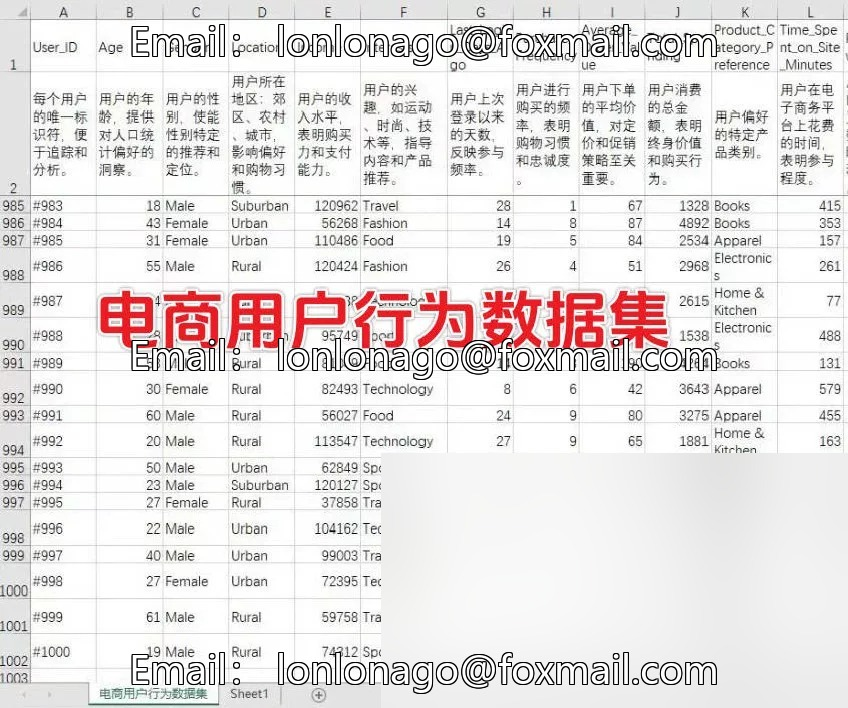
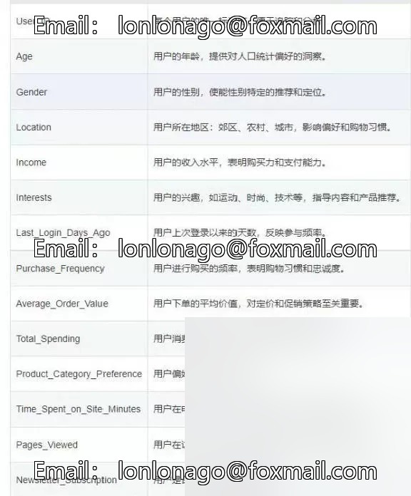

# E-commerce user behavior dataset 1000 rows

## Body

E-commerce user behavior dataset 1000 rows

This dataset is a detailed record of user behaviors and preferences on e-commerce platforms, which can be used to construct user profiles, formulate data-driven marketing strategies, and improve conversion rates and user retention rates.

The dataset collects user basic information, behavioral habits, and interaction data from an e-commerce platform. It includes basic attributes such as user age, gender, residential region, and income level, as well as dynamic indicators such as their interest preferences, login frequency, purchasing behavior, and platform interactions.

Dataset focuses on the e-commerce field, aiming to reveal its preferences and needs through in-depth analysis of user behavior. Through these data, merchants can better understand consumers, formulate effective market strategies, meet user expectations, and promote business development.
Problem description
Purchase behavior analysis
User segmentation
User activity analysis
Personalized recommendation prediction

web-based shipment, can be directly photographed and shipped.

The dataset covers e-commerce user behavior with indicators such as age, gender, location, income, interests, login days, purchase frequency, order value, and is used for user profiles, grouping, activity analysis and personalized recommendations.

<!-- AI_ENRICHED -->

## Images

## Payment

Here is a pay link on Stripe ( https://buy.stripe.com/3cs8yP7sY87d0vu9AB ). Please contact me lonlonago@foxmail.com after funding $89, and I will send you a complete data files , thank you!

